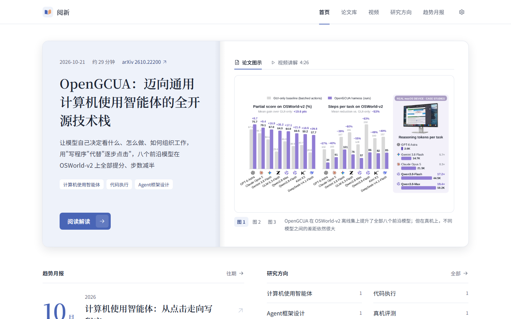
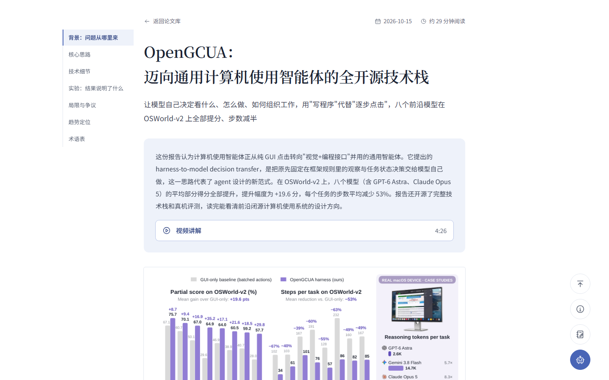

# 阅新 · AI 前沿论文精读

自托管的 AI 论文精读站：定时挑出值得读的新论文，用大模型写成中文解读和带双语字幕的讲解视频，每月汇总成趋势月报，并推送到邮箱、飞书、企业微信或钉钉。





- **自动选题**：从 HF Daily Papers、arXiv 和 Semantic Scholar 采集，按热度和你关注的方向筛选，再让大模型精选。
- **中文解读**：读取 arXiv 全文和原图，写成覆盖问题、贡献、机制、证据和局限的研究文章。
- **讲解视频**：大模型写分镜和 Remotion 动画代码，渲染成 16:9 视频，配中英字幕、背景音乐和可选旁白。
- **阅读工作台**：边读边向 AI 追问、记笔记；论文和月报共用。
- **可调**：模型、提示词、视频风格、定时计划和推送渠道都在网页后台配置，提示词改动可先试写对比再启用。


## 快速开始

需要：

- Node.js 22 或更高版本
- 一个大模型：Anthropic、OpenAI 兼容接口、Gemini 等的 API Key；或者 ChatGPT 订阅（在后台用设备码登录，不需要 Key）
- 能访问 huggingface.co 和 arxiv.org 的网络（国内见下方「网络」）

```bash
git clone https://github.com/zgdhhy/YueXin.git
cd YueXin
npm install
cp .env.example .env
```

打开 `.env`，修改两项：

- `ADMIN_PASSWORD`：登录密码
- `SESSION_SECRET`：至少 32 个字符的随机串，可以用 `node -e "console.log(require('crypto').randomBytes(32).toString('hex'))"` 生成

开两个终端，分别启动网站和任务进程（worker，负责选题、解读和视频渲染）：

```bash
npm run dev:web       # 网站：http://localhost:3000
npm run dev:worker
```

打开 http://localhost:3000 ，用 `ADMIN_PASSWORD` 登录。此时站点还没有内容，点右上角齿轮进入管理后台，完成三步生成第一篇解读：

1. **模型**页：添加一个服务商，填 API Key，点「测试连接」。
2. 同一页的「工作流」区：选择默认模型并保存。各环节默认都用它。
3. **任务概览**页：展开「新建解读任务」，点「开始运行」。

选题默认关注大语言模型、智能体、多模态等 6 个方向，可在「选题与方向」页修改。想先快点看到结果，可以在「视频 → 生成设置」关掉「解读完成后自动生成讲解视频」。

这样一次从选题到解读（和视频）的流程称为一次**运行**，要几分钟到十几分钟，进度和失败原因都显示在任务概览页。完成后解读出现在首页和论文库。第一次渲染视频会联网下载 Chrome Headless Shell。

### 网络

国内访问 huggingface.co 不稳定，可在 `.env` 设置 `HF_ENDPOINT=https://hf-mirror.com`，或者设置 `HTTPS_PROXY=http://127.0.0.1:7890` 走代理。

## 命令行

不打开网页，直接在终端执行一次运行（不需要启动 worker）。解读编号见后台「内容管理」：

```bash
npm run run-once                       # 按当前配置自动选题
npm run run-once -- 2610.22200         # 解读指定的 arXiv 论文
npm run run-once -- --video 1          # 只重做解读 #1 的视频
npm run run-once -- --report 2026-10   # 生成指定月份的趋势月报
```

## 部署到服务器

建议 2 核 4GB 内存以上（视频渲染比较耗资源），已安装 Docker。

```bash
git clone https://github.com/zgdhhy/YueXin.git && cd YueXin
cp .env.example .env    # 改 ADMIN_PASSWORD、SESSION_SECRET，SITE_URL 填 https://你的域名
docker compose build
docker compose up -d
docker compose logs -f worker   # 查看定时计划与运行日志
```

web 只监听 `127.0.0.1:3000`，对外访问需要反向代理并配置 HTTPS，例如 Caddy：

```
你的域名 {
  reverse_proxy 127.0.0.1:3000
}
```

所有数据（SQLite 数据库、论文原图、视频、音乐）都在 `./data`，先 `docker compose stop` 再备份这个目录。

升级：`git pull` 后重新执行 `docker compose build` 和 `docker compose up -d`，数据库迁移在启动时自动执行。

## 配置

`.env` 只放启动必需的少数设置，模型、提示词、定时计划、视频和通知都在后台配置，详见 [后台功能](docs/features.md)。

| 变量 | 说明 |
|---|---|
| `ADMIN_PASSWORD` | 登录密码（前台、后台共用） |
| `SESSION_SECRET` | 会话加密密钥，至少 32 个字符 |
| `SITE_URL` | 站点公网地址（如 `https://example.com`），用于推送消息中的链接 |
| `DATA_DIR` | 数据目录，默认 `./data` |
| `HF_ENDPOINT` | Hugging Face 地址，默认 `https://huggingface.co` |
| `HTTPS_PROXY` | 可选，出网代理 |
| `SMTP_HOST` `SMTP_PORT` `SMTP_USER` `SMTP_PASS` `SMTP_FROM` | 可选，邮件推送的默认发信服务器（也可在后台「通知」页填写） |
| `RENDER_CONCURRENCY` | 可选，视频渲染并发数 |
| `REMOTION_BROWSER` | 可选，指定 Chrome 可执行文件路径 |

## 工作原理

web 和 worker 是两个进程，只通过 SQLite 协作：web 把运行加入队列，worker 按定时计划发起运行并串行执行。一次**运行**依次经过：

1. **采集**：从 HF Daily Papers（带社区点赞数）和 arXiv（按关注方向分类）拉取近几天的新论文；按后台设置的新旧比例，部分名额从 Semantic Scholar 的近几个月高引论文中选。
2. **初筛**：按热度、主题关键词和头部机构打分，去掉推荐过的，取前 20 篇左右。
3. **精选**：大模型阅读标题和摘要，选出推荐论文和 2–3 篇备选。
4. **解读**：读取 arXiv HTML 全文和原图（没有时退回 PDF），写成中文研究文章，有实质联系时关联历史推荐。
5. **视频**：大模型写 8–12 个镜头的讲解脚本，再为每个镜头写 Remotion 动画代码，渲染成视频。
6. **通知**：推送新解读、新月报和运行失败。

每月 1 日另有一个定时计划，汇总上个月的解读生成**趋势月报**。

```
apps/web        Next.js：前台阅读站 + /admin 后台
apps/worker     定时计划与运行队列
packages/core   数据库（SQLite + Drizzle）、大模型适配、流水线
packages/video  Remotion 视频工程：镜头组件库、渲染、音乐合成
data/           运行数据（不进仓库）
```

术语见 [GLOSSARY.md](GLOSSARY.md)，关键设计决策见 [docs/adr/](docs/adr/)，开发与测试见 [docs/development.md](docs/development.md)。

## 限制

- 单用户：整个站点（包括阅读页）都需要登录，适合当个人知识库，不能直接对外公开阅读。
- 论文只来自 arXiv（可指定 arXiv ID），选题来源偏向 AI 领域，不能导入本地 PDF。
- 界面只有中文，桌面优先，手机布局没有专门适配。
- 费用取决于你选的模型。实测一篇解读约输入 2.4 万、输出 1.5 万 token；生成视频还要为讲解脚本和每个镜头（8–12 个）各调用一次模型。
- 视频渲染吃 CPU 和内存，低配机器可以在后台「视频 → 生成设置」关闭视频生成。

## 问题反馈

欢迎在 [Issues](https://github.com/zgdhhy/YueXin/issues) 报告问题。也接受 PR，较大的改动请先开 issue 讨论。

## 许可证

代码以 [MIT](LICENSE) 许可发布。

视频部分依赖的 [Remotion](https://www.remotion.dev/license) 有自己的许可：个人和 3 人以内的公司可免费使用，更大的公司需要购买 Remotion 授权。自带字体使用 SIL OFL 许可，见 `apps/web/public/fonts/`；服务商目录整理自 [CC Switch](docs/third-party/cc-switch.md)（MIT）。解读和视频中引用的论文原图，版权归论文作者。
